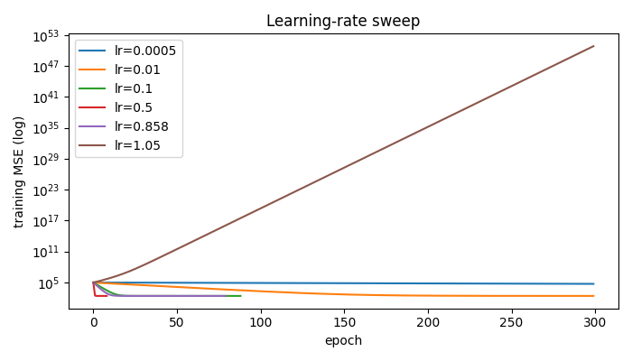
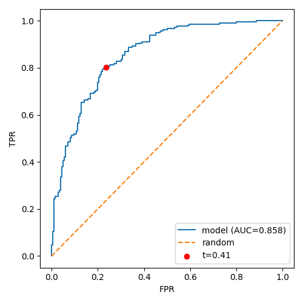
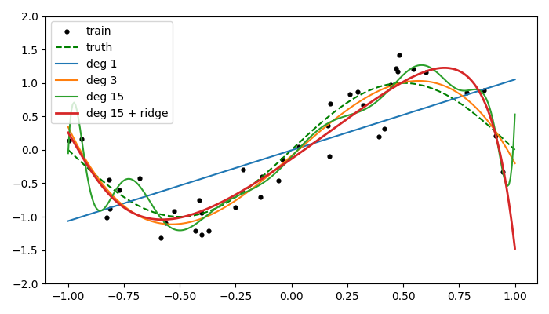
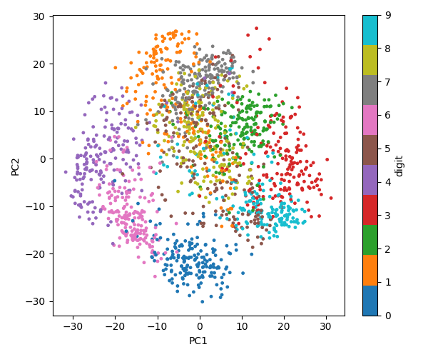

# Machine Learning: Mathematics and Python Implementation

## Author

- Student: Tariq Hussain
- GitHub: Nitetraveler
- Training provider: Alnafi

## Project Overview

This project implements classical machine learning
algorithms from their mathematical definitions and
verifies their numerical correctness against scikit-learn.

The Northwind Utilities scenario covers housing price
regression and customer churn classification.

## Implementation Status

| Component | Status |
|---|---|
| Environment setup | Passed |
| Task 1: Data preparation and linear algebra | Passed |
| Task 2: Ordinary least squares | Passed |
| Task 3: Gradient descent | Passed |
| Task 4: Logistic regression | Passed |
| Task 5: Classification metrics | Passed |
| Task 6: Ridge regression and cross-validation | Implemented; MSE exception documented |
| Task 7: Principal component analysis | Passed |
| Task 8: Production churn pipeline | Passed |
| Challenge: Newton/IRLS logistic regression | Passed |

## Verified Results

- Official validation: 9/10 checks passed.
- Mathematical unit tests: 15/15 passed.
- Supplementary final validation: Passed.
- Production churn test ROC AUC: 0.845934593459346.
- Best logistic regression C: 0.01.
- Scratch probability difference: 8.107496538845016e-07.
- PCA components for 90% variance: 21.
- Newton convergence: 7 iterations.
- Newton/GD coefficient difference: 8.881784197001252e-16.
- Newton/sklearn difference: 1.735775509437154e-09.
- Newton final gradient norm: 1.161540838980515e-17.

## Task 6 Reference Discrepancy

The official acceptance criterion requires test MSE
strictly below 0.15.

The supplied deterministic experiment produces:

- Scratch implementation: 0.1561991018883563.
- Independent sklearn implementation: 0.1561991018883562.
- Absolute difference: 1.1102230246251565e-16.

The original experiment, implementation, output and
grading threshold have been preserved.

Independent diagnostics reproduce the discrepancy.
Clarification from Alnafi remains pending.

See [Task 6 discrepancy report](evidence/task6-reference-discrepancy.md).

## Environment

- Ubuntu 24.04
- Python 3.12.3
- NumPy 1.26.4
- SciPy 1.13.1
- pandas 2.2.2
- scikit-learn 1.5.1
- Matplotlib 3.8.4
- joblib 1.4.2
- pytest 8.2.2

## Repository Structure

    mlmath/       Mathematical implementations
    scripts/      Analysis, training, scoring and validation
    tests/        Mathematical unit tests
    data/         Synthetic datasets and CLI input examples
    outputs/      JSON metrics, CSV predictions and PNG plots
    models/       Persisted churn model
    evidence/     Execution logs and verification reports
    exercises/    Preserved exercise attempts

## Installation

    python3 -m venv .venv
    source .venv/bin/activate
    python -m pip install -r requirements.txt
    export PYTHONPATH="$PWD${PYTHONPATH:+:$PYTHONPATH}"
    export MPLBACKEND=Agg

## Reproduce the Lab

Run from the repository root in the activated environment.

    python scripts/make_data.py
    python scripts/task1_explore.py
    python scripts/task2_ols.py
    python scripts/task3_gd.py
    python scripts/task4_logreg.py
    python scripts/task5_metrics.py
    python scripts/task6_ridge.py
    python scripts/task7_pca.py
    python scripts/train_churn.py
    python scripts/challenge_newton.py

## Customer Scoring

    python scripts/predict_churn.py \
      --input data/new_customers.csv \
      --output outputs/scored.csv

The persisted model contains the required feature order,
default threshold and scikit-learn version.

Only load trusted joblib model files.

## Validation

    python -m pytest -q tests
    python scripts/validate.py
    sha256sum -c evidence/SHA256SUMS

The original official validator currently reports 9/10
because of the documented Task 6 MSE discrepancy.

The challenge and supplementary validation have passed.

## Analysis Plots

### Gradient Descent Learning Rates

### Customer Churn ROC Curve

### Bias-Variance Trade-off

### Principal Component Analysis

## Evidence

- [Official validation](evidence/final-official-validation.log)
- [Supplementary validation](evidence/final-supplementary-validation.log)
- [Challenge validation](evidence/challenge-validation.log)
- [Task 8 validation](evidence/task8-validation.log)
- [Task 6 discrepancy](evidence/task6-reference-discrepancy.md)
- [Final completion report](evidence/final-completion.md)

## Academic Integrity

The implementation, guided exercises, troubleshooting
and documentation were completed with AI assistance.

Original exercise attempts, numerical outputs,
failed checks and corrective evidence are retained.

Official grading thresholds have not been relaxed.

## Acknowledgement

Alnafi training materials provided the lab scenario,
algorithm specifications and validation requirements.
